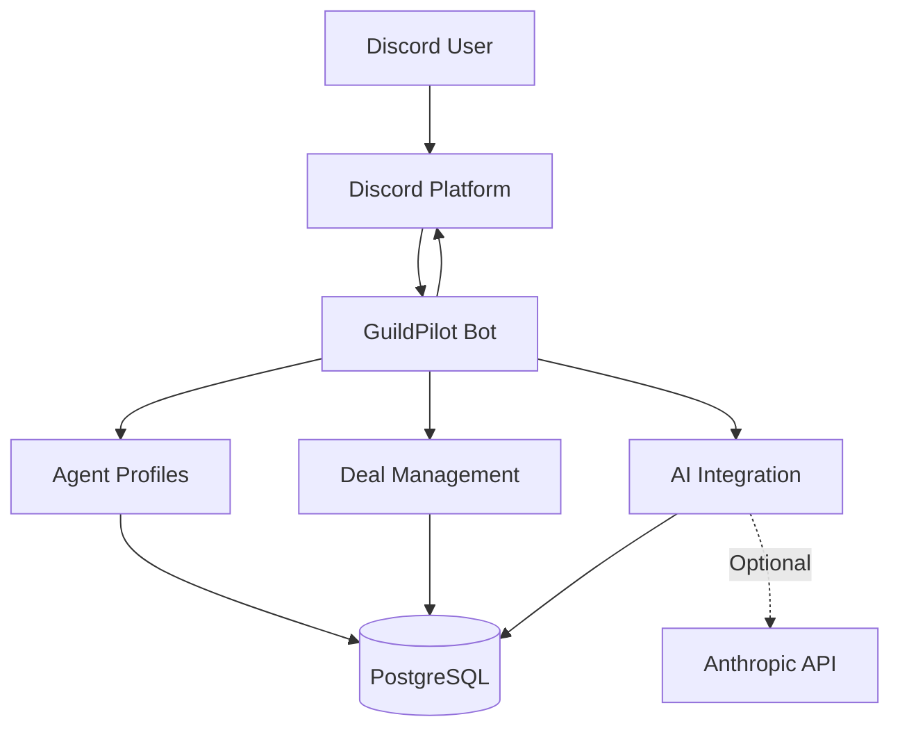

# GuildPilot

**AI Agents & Discord Automation Platform**

[](https://github.com/Arbuzyan/GuildPilot/actions/workflows/main.yml)
[](https://github.com/Arbuzyan/GuildPilot/releases/latest)
[](LICENSE)
[](https://www.python.org/)

GuildPilot is a Python-based Discord automation platform for publishing approved sales records, scheduling transparent announcements, managing agent profiles, and providing AI-assisted conversations grounded in application data.

The project combines Discord integration, PostgreSQL persistence, automated scheduling, database migrations, and optional LLM integration in a Docker-based deployment.

**Current version: v1.0.0 — Stable Release**

[View Latest Release](https://github.com/Arbuzyan/GuildPilot/releases/latest)

---

## What it does

- Runs one explicitly configured Discord bot account.
- Publishes approved deal records to a configured Discord channel.
- Schedules publications using PostgreSQL-backed state.
- Prevents duplicate publication and protects cancelled deals.
- Keeps conversation history and can answer with Anthropic using verified application data.
- Manages persistent agent profiles and Discord user identities.
- Provides sales statistics and monthly sales goals.
- Stores absolute timestamps in UTC and interprets scheduling in the host computer's timezone.

The public build excludes the former multi-account reaction/comment automation. It does not simulate team activity or coordinate multiple bot accounts. The `sale_engagements` table remains in the schema for historical compatibility; the public bot does not generate new simulated engagement records.

## Features

### Discord Automation
- Single explicitly configured Discord bot account.
- Automated publication of approved sales records.
- Scheduled Discord announcements.
- Live sales board.
- Slash commands for deal and profile management.
- Duplicate-publication protection.

### Deal Management
- Create and manage manual sales records.
- Approve pending deals.
- Edit manually created sales.
- Safely cancel manual deals while preserving their history.
- Protect cancelled and imported deals from unsupported operations.
- Track sales statistics and monthly goals.

### Agent Profiles
- Persistent agent profiles stored in PostgreSQL.
- Discord identity mapping using stable Discord user IDs.
- Automatic profile creation on first interaction.
- Individual profile configuration and daily limits.

### AI Integration
- Optional Anthropic API integration.
- AI-assisted conversational interface.
- Conversation history persistence.
- Responses grounded in verified application data.

### Database and Reliability
- PostgreSQL 17.
- SQLAlchemy ORM.
- Alembic database migrations.
- UTC-aware timestamp handling for supported fields.
- Persistent scheduling state.
- Transaction-aware deal cancellation.

---

## Architecture

GuildPilot is organized into separate application modules:

```text
app/
├── agents/       # Agent profiles and initialization
├── ai/           # AI integration
├── core/         # Shared application configuration
├── db/           # Database models and database access
├── deals/        # Deal-related business logic
└── discord/      # Discord bot and command handling

migrations/       # Alembic migrations
tests/            # Automated tests
data/             # Local data directory
```

### High-level architecture



---

## Technology Stack

| Category | Technologies |
|---|---|
| Language | Python 3.13 |
| Discord Integration | discord.py |
| Database | PostgreSQL 17 |
| ORM | SQLAlchemy |
| Migrations | Alembic |
| AI Integration | Anthropic API |
| Containerization | Docker, Docker Compose |
| Testing | Python unittest |
| CI/CD | GitHub Actions |

---

## Requirements

- Python 3.13
- Docker Desktop with Docker Compose
- PostgreSQL 17 (provided by the included Compose file)
- A Discord application/bot with the Message Content Intent enabled
- An Anthropic API key only if AI responses are enabled

---

## Setup

### 1. Clone the repository

```bash
git clone https://github.com/Arbuzyan/GuildPilot.git
cd GuildPilot
```

### 2. Configure environment variables

Copy `.env.example` to `.env`.

Windows CMD:

```cmd
copy .env.example .env
```

macOS/Linux:

```bash
cp .env.example .env
```

Configure the required values in `.env`.

At minimum, configure:

- `POSTGRES_PASSWORD`
- `DATABASE_URL`
- `ROSA_DISCORD_TOKEN`
- `ROSA_DISCORD_CHANNEL_ID`

Optional:

- `DISCORD_GUILD_ID`
- `ANTHROPIC_API_KEY`

Use a long PostgreSQL password containing letters and digits only, and use the same value in `POSTGRES_PASSWORD` and `DATABASE_URL`.

The Docker Compose configuration uses the internal service hostname `postgres`. Local Python runs use `localhost`.

Never commit `.env` or expose your credentials.

### 3. Start GuildPilot

Build and start PostgreSQL and the bot:

```bash
docker compose up --build -d
```

Check the bot logs:

```bash
docker compose logs -f bot
```

The bot waits for the PostgreSQL health check, applies Alembic migrations, and then starts.

The database is published on host port `5434` to avoid colliding with an existing local PostgreSQL container.

### 4. Discord configuration

Enable **Message Content Intent** in the Discord Developer Portal.

Grant the bot permissions to:

- View channels.
- Send messages.
- Embed links.
- Use application commands.

On `/sale` and `/profile`, GuildPilot links the action to the invoking Discord member by their stable Discord user ID.

A matching agent/profile is created automatically on first use, and the member's current Discord display name is used as the agent name. Existing seed agents and historical sales remain intact.

---

## Commands

| Command | Description |
|---|---|
| `/sale` | Create a manual sales card attributed automatically to the invoking Discord member |
