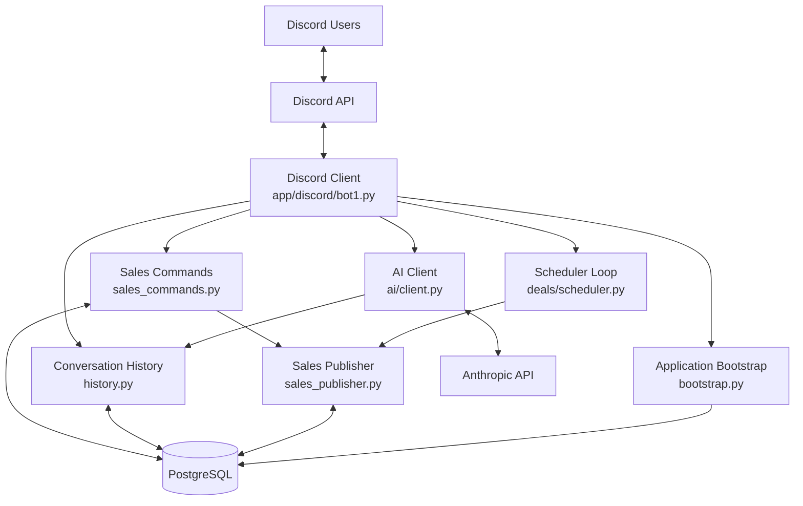

# GuildPilot Architecture

## Overview

GuildPilot is a Python-based Discord automation platform for managing sales records, publishing approved sales, scheduling announcements, maintaining agent profiles, and providing AI-assisted conversations.

The application integrates:

- Discord API through `discord.py`
- PostgreSQL for persistent storage
- SQLAlchemy for database access
- Alembic for schema migrations
- Anthropic API for AI-generated responses
- Docker Compose for deployment

## 1. High-level architecture



## 2. Application entry points

### Discord bot

The primary application entry point is:

```bash
python -m app
```

Python executes `app/__main__.py`, which imports and invokes `main()` from `app.discord.bot1`.

The startup sequence is:

1. Read configuration from `.env`.
2. Validate the Discord bot token.
3. Run `bootstrap_application_data()`.
4. Create missing configured agent profiles.
5. Connect the Discord client using `client.run(token)`.
6. Synchronize application commands after the client becomes ready.
7. Start the background scheduling loop.

The bootstrap operation is idempotent: existing agents and profiles are preserved.

### Excel import

Excel import is a separate application entry point:

```bash
python -m app.main path/to/deals.xlsx
```

It opens a database session and calls `import_deals()`.

This command does not start the Discord bot. Database schema creation and updates are handled by Alembic.

## 3. Main application components

### 3.1 Discord integration

Location: `app/discord/`

| Module | Responsibility |
|---|---|
| `bot1.py` | Main Discord client, events, startup and message handling |
| `sales_commands.py` | Slash commands, sale forms, statistics and moderation |
| `sales_publisher.py` | Manual and scheduled publication to Discord |
| `history.py` | Saving and retrieving conversation history |
| `sales_commands.py` | Sale embeds, interactive components and command registration |

The bot uses Discord's default intents with `message_content` enabled.

The `on_message` handler supports:

- `!rosa` — AI-assisted conversation with Rosa Delgado.
- `!postdeal` — manual publication of the next eligible deal.

Application commands are synchronized globally when `DISCORD_GUILD_ID` is not configured. When it is configured, commands are synchronized to that Discord server.

### 3.2 Agent management

Location: `app/agents/`

Agent records are stored in PostgreSQL. Discord members are associated with agents through their stable Discord user IDs.

The `get_or_create_discord_agent()` function:

- Finds an existing agent by Discord user ID.
- Creates an agent if no association exists.
- Resolves display-name collisions.
- Creates a default agent profile when one is missing.

Agent profiles contain personality, communication style, language, system prompt, enabled state and daily publication limit.

### 3.3 Sales and publication logic

Location: `app/deals/`

The sales module contains business rules for selecting eligible deals, validating publication, scheduling and cancellation.

Important modules:

| Module | Responsibility |
|---|---|
| `sales.py` | Deal selection and daily publication limits |
| `publication.py` | Publication eligibility checks |
| `schedule_queries.py` | Retrieval of pending schedules |
| `scheduler.py` | Background scheduling loop |
| `cancellation.py` | Safe cancellation of manually created deals |
| `sales_publisher.py` in `app/discord/` | Sending deal cards to Discord |

A deal is selected for automatic next-deal publication when:

- It belongs to the requested agent.
- Its status is `Issued`.
- No corresponding `DealPost` exists.

The selection is ordered by deal date and then deal ID.

Publication eligibility rejects cancelled deals and deals that already have a publication record.

### 3.4 Scheduling

The scheduler runs as an asynchronous background task started by the Discord client's `on_ready` event.

The configured check interval is 30 seconds.

The scheduler:

1. Retrieves pending and burst-pending schedules.
2. Marks schedules older than the scheduler startup time as skipped.
3. Waits for future schedules.
4. Marks due schedules as processing.
5. Invokes scheduled publication.
6. Updates the final schedule status.
7. Closes the database session and repeats.

Supported schedule statuses used by this flow include:

- `pending`
- `burst_pending`
- `processing`
- `processing_burst`
- `completed`
- `limit_reached`
- `failed`
- `skipped`
- `cancelled`

The `burst_pending` path bypasses the normal daily publication limit.

### 3.5 AI integration

Location: `app/ai/client.py`

GuildPilot uses the Anthropic SDK to generate AI responses.

The application passes:

- The agent's system prompt.
- Conversation history.
- The configured Anthropic model.
- A maximum output limit of 300 tokens.

The synchronous Anthropic request is executed through `asyncio.to_thread()` in the Discord message handler to avoid blocking the asynchronous Discord event loop.

AI responses require `ANTHROPIC_API_KEY`. The bot can start without this optional integration configured, but AI response generation will not be available.

For requests containing `latest deal`, the application retrieves the latest deal context from PostgreSQL and adds it to the AI request with instructions not to invent or modify deal facts.

### 3.6 Conversation history

Location: `app/discord/history.py`

Conversation messages are stored in `conversation_messages`.

History retrieval is scoped by:

- Agent ID.
- Discord channel ID.

The default history limit is 10 messages. Messages are retrieved newest-first from the database and reversed before being sent to the AI client, preserving chronological order.

## 4. Database access

Location: `app/db/`

The project uses SQLAlchemy 2.0.

Main modules:

- `database.py` — engine, session factory and session lifecycle.
- `models.py` — declarative ORM models.

The database engine uses `pool_pre_ping=True`.

`SessionLocal` creates database sessions, while `get_db()` provides a generator that closes sessions after use.

Alembic is the sole schema management mechanism. Application bootstrap creates application data, not database tables.

## 5. Transaction and concurrency considerations

### Scheduled publication

Scheduled publication locks the target deal row using SQLAlchemy's `with_for_update()`.

This serializes publication against cancellation operations that also lock the deal row on databases supporting `SELECT FOR UPDATE`, including PostgreSQL.

### Cancellation

The cancellation service:

- Locks the deal row.
- Validates that the deal was created manually.
- Changes its status to `Cancelled`.
- Cancels active schedules.
- Returns the associated publication record.

The caller controls the transaction and decides when to commit or roll back.

### Discord publication records

After a Discord card is sent, GuildPilot stores its Discord message ID and channel ID in `deal_posts`.

This allows later operations to locate and update the existing card.

## 6. Deployment architecture

Docker Compose defines two services:

- `postgres` — PostgreSQL 17 database.
- `bot` — Python 3.13 application container.

The bot waits for the database health check before starting.

The Dockerfile runs:

```bash
alembic upgrade head && python -m app
```

The PostgreSQL container uses a named Docker volume for persistent data.

The database port is published on `127.0.0.1:5434`, while the bot connects through the Compose service hostname `postgres` on port `5432`.

## 7. Testing and continuous integration

Tests are located in `tests/`.

The GitHub Actions workflow:

- Runs on pushes and pull requests targeting `main`.
- Uses Ubuntu.
- Sets up Python 3.13.
- Installs `requirements.txt`.
- Executes:

```bash
python -m unittest discover -s tests -v
```

## 8. Current scope and limitations

- The primary runtime is a Discord bot, not an HTTP REST API.
- The main configured bot identity is Rosa Delgado.
- AI response generation depends on Anthropic API configuration.
- Excel import is a separate command.
- Database schema changes must be applied through Alembic.
- Existing databases require schema review before migration adoption.
- `deals.date` remains a timestamp without time zone because its historical business meaning has not been standardized.

## Related documentation

- [Database](database.md)
- [Deployment](deployment.md)
- [Project README](../README.md)
`