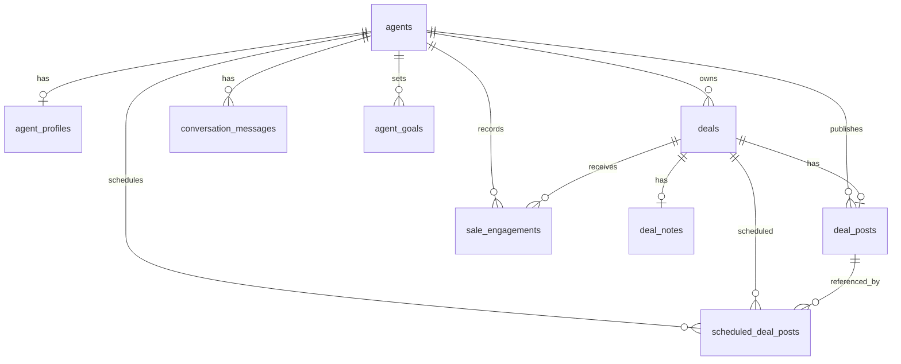

# GuildPilot Database

## Overview

GuildPilot uses PostgreSQL as its persistent data store and SQLAlchemy 2.0 as its ORM.

Database schema changes are managed exclusively through Alembic migrations. The application does not create or modify tables automatically during startup.

The database contains nine application tables and the Alembic version table.

## 1. Database models

ORM models are defined in `app/db/models.py`.

### 1.1 Agent

Table: `agents`

Stores agent identities used by the application.

Important fields:

- `id` — primary key.
- `name` — unique agent name.
- `discord_user_id` — nullable, unique Discord user ID.

Relationships:

- One agent can have an associated agent profile.
- One agent can be associated with multiple deals and conversation messages.
- One agent can have multiple scheduled publications and sale engagement records.

Discord identity is associated through the stable Discord user ID rather than relying exclusively on a display name.

### 1.2 AgentProfile

Table: `agent_profiles`

Stores agent configuration and behavior settings.

Important fields:

- `agent_id` — unique foreign key to `agents`.
- `personality` — personality description.
- `communication_style` — communication style.
- `language` — response language; defaults to English.
- `system_prompt` — AI system instructions.
- `discord_bot_id` — nullable bot identifier.
- `enabled` — profile enabled state.
- `daily_limit` — daily publication limit; defaults to 3.

Each agent can have one associated profile.

### 1.3 Deal

Table: `deals`

Stores sales and deal information.

Important fields:

- `id` — primary key.
- `date` — deal date, stored without time zone.
- `agent_id` — foreign key to `agents`.
- `client` — client information.
- `carrier` — carrier information.
- `product` — product information.
- `annual_premium` — annual premium amount.
- `term_months` — contract term; defaults to 12.
- `status` — current deal status.
- `policy_number` — unique policy identifier.
- `data_type` — identifies the deal source.

The `data_type` field distinguishes manually created Discord sales from other imported or existing records. Manually created sales use `manual_discord`.

A deal can be associated with a publication, schedule, note and engagement records.

### 1.4 ConversationMessage

Table: `conversation_messages`

Stores messages used for AI conversation history.

Important fields:

- `id` — primary key.
- `agent_id` — foreign key to `agents`.
- `channel_id` — Discord channel identifier.
- `user_id` — Discord user identifier.
- `role` — message role.
- `content` — message text.
- `created_at` — timezone-aware timestamp, defaulting to UTC.

Conversation history is retrieved by agent and Discord channel. The bot normally loads the latest 10 messages for a response.

### 1.5 DealPost

Table: `deal_posts`

Stores records of deal cards published to Discord.

Important fields:

- `id` — primary key.
- `deal_id` — unique foreign key to `deals`.
- `agent_id` — foreign key to `agents`.
- `channel_id` — Discord channel identifier.
- `discord_message_id` — nullable Discord message identifier.
- `posted_at` — timezone-aware publication timestamp.

The unique `deal_id` constraint ensures that a deal has at most one associated publication record.

### 1.6 ScheduledDealPost

Table: `scheduled_deal_posts`

Stores scheduled deal publications.

Important fields:

- `id` — primary key.
- `agent_id` — foreign key to `agents`.
- `deal_id` — foreign key to `deals`.
- `scheduled_at` — timezone-aware scheduled timestamp.
- `status` — schedule processing status.
- `deal_post_id` — nullable foreign key to `deal_posts`.
- `created_at` — timezone-aware creation timestamp.

The scheduler uses these records to identify pending publications and update their processing status.

### 1.7 SaleEngagement

Table: `sale_engagements`

Stores engagement records associated with published deals.

Important fields:

- `id` — primary key.
- `deal_id` — foreign key to `deals`.
- `agent_id` — foreign key to `agents`.
- `discord_message_id` — Discord message identifier.
- `comment_text` — nullable comment text.
- `engaged_at` — timezone-aware timestamp.

The model remains part of the database schema.

### 1.8 DealNote

Table: `deal_notes`

Stores notes associated with deals.

Important fields:

- `id` — primary key.
- `deal_id` — unique foreign key to `deals`, with `ON DELETE CASCADE`.
- `text` — note content.
- `updated_at` — timezone-aware update timestamp.

Each deal can have one associated note.

### 1.9 AgentGoal

Table: `agent_goals`

Stores monthly sales goals for agents.

Important fields:

- `id` — primary key.
- `agent_id` — foreign key to `agents`, with `ON DELETE CASCADE`.
- `year` — goal year.
- `month` — goal month.
- `amount` — target amount.

These records are used by sales statistics and goal-related commands.

## 2. Entity relationships

The following diagram summarizes the main database relationships.



The diagram describes the principal foreign-key relationships. It does not replace the actual SQLAlchemy model definitions or database constraints.

## 3. Database access layer

Location: `app/db/database.py`

The database access layer provides:

- SQLAlchemy engine creation.
- Session factory configuration.
- Session lifecycle management.
- Engine disposal.

The engine is configured with `pool_pre_ping=True` to check connections before using them.

The `SessionLocal` factory uses:

- `autoflush=False`
- `autocommit=False`
- `expire_on_commit=False`

`get_db()` provides a database session and closes it when the operation finishes.

A missing `DATABASE_URL` causes database initialization to fail with a configuration error.

## 4. Schema migrations

Location: `migrations/`

Alembic manages the database schema.

Current revision chain:

```text
aeb3e4d561c0
    |
    v
c41d9e7a2b60
    |
    v
d7f4a91c2e60
```

### 4.1 Initial schema

Revision: `aeb3e4d561c0`

Creates the initial application database schema.

Its timestamp columns are deliberately defined as timezone-naive so that the following migration can apply the documented historical interpretation.

### 4.2 Timezone-aware timestamps

Revision: `c41d9e7a2b60`

Converts six absolute-time columns to PostgreSQL `TIMESTAMP WITH TIME ZONE`.

The historical interpretation is:

| Column | Interpretation |
|---|---|
| `conversation_messages.created_at` | UTC |
| `deal_notes.updated_at` | UTC |
| `deal_posts.posted_at` | UTC |
| `sale_engagements.engaged_at` | UTC |
| `scheduled_deal_posts.created_at` | UTC |
| `scheduled_deal_posts.scheduled_at` | Europe/Moscow for the audited historical records |

The `scheduled_deal_posts.scheduled_at` conversion has an additional safety condition.

For an existing populated table, the migration proceeds only when the rows match the audited historical IDs 73, 74 and 75 with their exact original naive timestamps.

An empty table is allowed for a fresh installation.

Any other populated set causes the migration to abort before conversion. The data must be audited and an explicit interpretation policy defined before retrying.

**Important:** `deals.date` is intentionally unchanged and remains `TIMESTAMP WITHOUT TIME ZONE`. Its historical business meaning has not been standardized.

### 4.3 Discord identity

Revision: `d7f4a91c2e60`

Adds the nullable `discord_user_id` column to `agents` and a unique constraint.

This enables stable mapping between Discord users and application agents.

## 5. Fresh database installation

For a fresh installation:

1. Create an empty PostgreSQL database.
2. Configure `DATABASE_URL`.
3. Run:

```bash
alembic upgrade head
```

4. Verify that all nine application tables and the `alembic_version` table exist.
5. Verify the six timezone-aware columns and the unchanged `deals.date` type.
6. Run:

```bash
alembic check
```

The check should be performed against the same database.

## 6. Existing database adoption

Existing databases require additional care.

### Database already has the baseline revision

If `alembic_version` contains:

```text
aeb3e4d561c0
```

Alembic considers the initial schema applied and proceeds with the remaining revisions.

The legacy schema must still be verified before applying the timezone migration.

### Database has no Alembic version

Do not run `alembic upgrade head` directly against a populated database with no Alembic version record.

The adoption procedure requires:

1. Creating and validating a backup.
2. Comparing every existing table, column and constraint with the initial baseline.
3. Reviewing the differences.
4. Applying the baseline stamp only after confirming the schema matches:

```bash
alembic stamp aeb3e4d561c0
```

5. Reviewing and applying the remaining migrations.

Never stamp an unknown or partially matching schema.

## 7. Backup and migration safety

- Test migrations on disposable database copies first.
- Validate backups before relying on them.
- Do not run downgrade against production without a verified backup and reviewed rollback plan.
- Do not apply production schema changes without explicit approval.
- Do not delete Docker volumes as a troubleshooting shortcut.
- Keep database credentials outside source control.

For the detailed deployment procedure, see [Deployment](deployment.md).

## Related documentation

- [Architecture](architecture.md)
- [Deployment](deployment.md)
- [Project README](../README.md)
